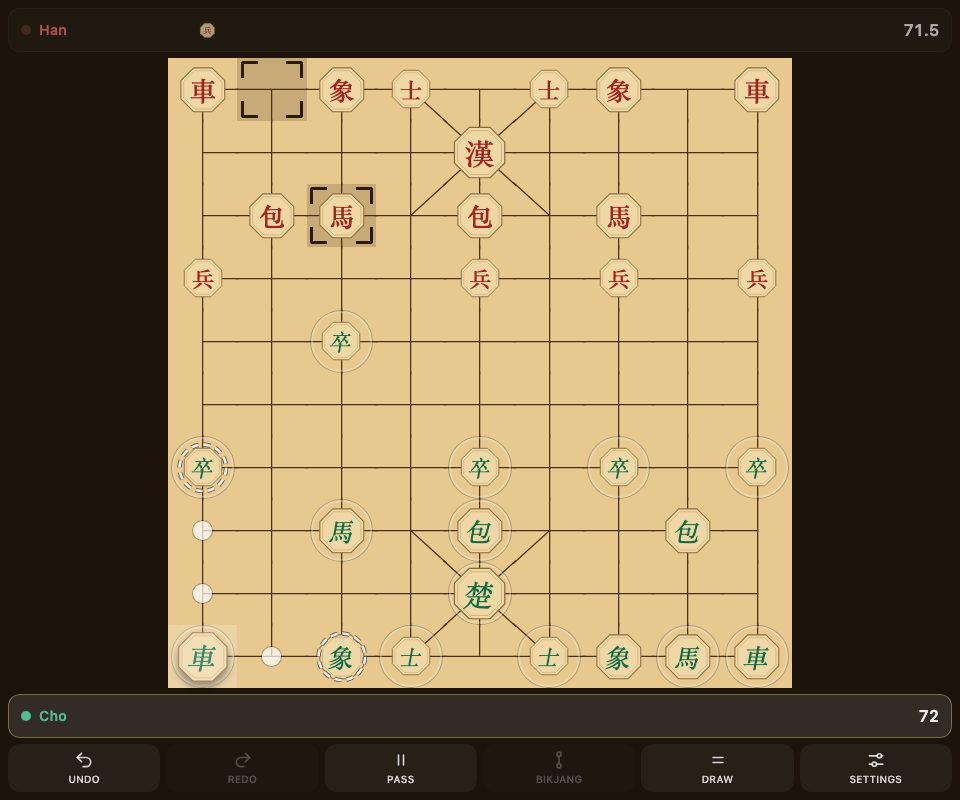
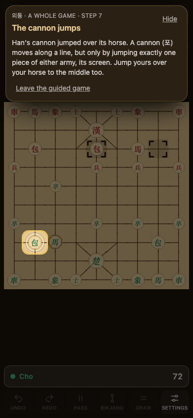
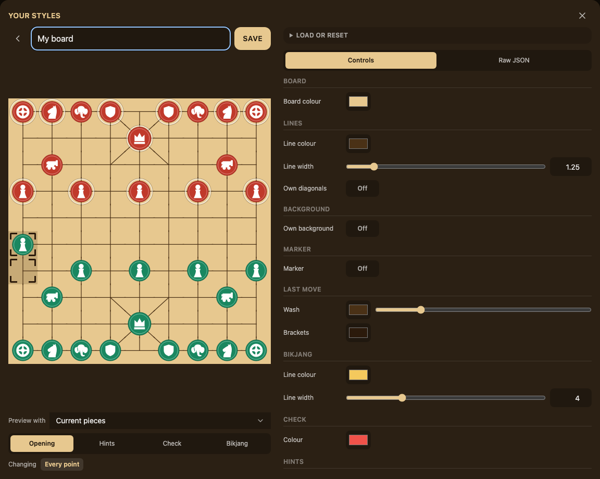

<p align="center">
  
</p>

<h1 align="center">Janggi · 장기</h1>

<p align="center"><strong>Also known as "Korean Chess". A new (old) game to get obsessed with if you love chess already.</strong></p>

I wanted to learn janggi, but the versions I found made it hard to get into.
So I built the version I wanted to exist: something super easy to jump into when waiting in line for something, on a bus, or just a bit bored and wanting something engaging to play. Hopefully you find it fun too!

<p align="center">
  <a href="https://janggi.neilarmstrong.dev/" target="_blank" rel="noopener noreferrer"><strong>Play Janggi</strong></a>
  &nbsp;·&nbsp;
  <a href="https://janggi.neilarmstrong.dev/?tutorial=true" target="_blank" rel="noopener noreferrer"><strong>Learn through a guided game</strong></a>
</p>

<p align="center">
  <a href="https://janggi.neilarmstrong.dev/" target="_blank" rel="noopener noreferrer">
    
  </a>
</p>

## Familiar if you have played chess, but a very different game

The goal is still to checkmate the general. However, how you get there is where janggi finds its own character.

The Cannon need another piece to jump over to move or capture. Chariots race along the open lines like a rook but can also cut through palace diagonals. Elephants are like horses in chess but move much further in one jump.

Before the first move, you choose the layout of your pieces, not just the same mirrored layout every game.

## Easy to get to grips with if you haven't played before

I created a simple <a href="https://janggi.neilarmstrong.dev/?tutorial=true" target="_blank" rel="noopener noreferrer">Guided game</a> that takes you through the difference pieces in a real simulated game. It explains the different moves, but also the special rules that make Janggi different from chess.

<p align="center">
  <a href="https://janggi.neilarmstrong.dev/?tutorial=true" target="_blank" rel="noopener noreferrer">
    
  </a>
</p>

Prefer to look around first? The
<a href="https://janggi.neilarmstrong.dev/learn.html" target="_blank" rel="noopener noreferrer">illustrated guide</a> gives a quickstart guide for each
each piece and its moves. The game and guide are available in English and
Korean; the Korean translation is still being refined, it is mostly machine translated at the moment so forgive any inaccuracies!.

## Play vs bots or humans

There is always a bot ready for another game. Eight strengths give you a ladder
to climb: beat one difficulty to unlock the next difficulty level, with separate progress for each army and
match format so when you are comfortable with one setup, you can learn the next. Bot games build your personal rating and record.

Or play a friend. Share a phone / tablet across a table, with an optional clock if you want a more intense match and
the unique Korean overtime rules (초읽기), or sign in with Google and send a private link to play
online. Local games offer Casual and Scored rules; online invitations are for
Casual games with friends.

## A board that feels like yours

Finish bot games to earn new boards and piece sets, then unlock the editor to
make and share your own if you like.

<p align="center">
  <a href="https://janggi.neilarmstrong.dev/" target="_blank" rel="noopener noreferrer">
    
  </a>
</p>

## Realtime music and sound

The soundtrack is synthesised in real time, drawing on traditional Korean
sanjo (산조): a gayageum solo over janggu drums, starting unhurriedly and
gathering pace. Here, three rhythmic stages follow the tension on the board:
jungmori (중모리) for the opening, jungjungmori (중중모리) as the fight develops,
and the faster jajinmori (자진모리) at its height. A separate, darker theme rises
when a general is in check.

## Play it wherever you want

Open it in your browser, or install it on your phone. Once loaded and cached,
local play works offline, including the bot. Your game stays where you left
it. Optional sign-in carries your progress, bot record and styles between
devices; the unfinished local board stays on its device. A save key can also
carry XP, beaten bots and custom styles by hand.

<a href="https://janggi.neilarmstrong.dev/" target="_blank" rel="noopener noreferrer"><strong>Come and play →</strong></a>

## Behind the board

Built with React, TypeScript and a janggi rules engine shared by local and
online play. I use acceptance tests (in playwright) first, then deliberately break the code to
check that the tests notice. The <a href="https://neilarmstrong.dev/software/janggi/" target="_blank" rel="noopener noreferrer">case study</a>
tells the story behind the project; <a href="docs/" target="_blank" rel="noopener noreferrer">research notes</a> and
<a href="https://janggi.neilarmstrong.dev/references.html" target="_blank" rel="noopener noreferrer">sources and credits</a> record
what went into the game.

<details>
<summary><strong>Run locally and contribute</strong></summary>

A pnpm workspace with six packages:

| Package             | Purpose                                                                           |
| ------------------- | --------------------------------------------------------------------------------- |
| `webapp/`           | React 19, Redux Toolkit, Tailwind CSS v4 and Vite PWA; game, guide and references |
| `engine/`           | Janggi rules shared by the app and API                                            |
| `shared/`           | Shared vocabulary, contracts and base tool configuration                          |
| `acceptance-tests/` | Playwright acceptance specs and their domain-specific language                    |
| `api/`              | Cloudflare Worker for opt-in sign-in, sync and online friend games                |
| `infra/`            | Cloudflare infrastructure declared with Alchemy                                   |

### Getting started

Use Node from `.nvmrc` (24.13.1) and pnpm from `package.json` (12.3.4).
With nvm and Corepack installed:

```bash
nvm install
nvm use
corepack enable
pnpm install --frozen-lockfile
pnpm start               # http://localhost:3000
```

The frontend can run without local API setup. To develop sign-in, sync or online
play against a local Worker, follow the
<a href="MANUAL-SETUP-STEPS.md#8-local-development-against-the-real-api-optional" target="_blank" rel="noopener noreferrer">manual setup steps</a>
and <a href="api/AGENTS.md" target="_blank" rel="noopener noreferrer">API instructions</a>.

### Checks and browser tests

```bash
pnpm checks              # lint, format, types and unit tests in every package
pnpm install-browsers    # one-time Chromium download for Playwright
pnpm start:preview       # build, then serve on http://localhost:3000
```

With preview running in another terminal:

```bash
pnpm acceptance-tests
pnpm acceptance-tests:pwa
```

Stop the dev server before starting preview on the same port. The main
acceptance suite also works with `pnpm start`; PWA tests require preview.
Use `WEBAPP_URL` to point browser tests at a different server.

Additional suites run separately from `pnpm checks`:

```bash
pnpm test:properties             # random legal games and invariants
pnpm test:bot-games              # whole games with the real bot under Node
pnpm acceptance-tests:bot-games  # whole bot games in the browser; needs a server
pnpm acceptance-tests:unreleased # gated work; needs a server
```

Work in progress can be enabled with `?IN_DEVELOPMENT=true`; it is on by default
on the dev server. This controls visibility only. Read <a href="AGENTS.md" target="_blank" rel="noopener noreferrer">AGENTS.md</a>
and the instructions in each package before contributing.

### The bot's engine

The bot uses <a href="https://github.com/fairy-stockfish/Fairy-Stockfish" target="_blank" rel="noopener noreferrer">Fairy-Stockfish</a>
through `fairy-stockfish-nnue.wasm`. Its files ship unmodified, with their
<a href="https://github.com/fairy-stockfish/Fairy-Stockfish/blob/master/Copying.txt" target="_blank" rel="noopener noreferrer">GPL-3.0 licence</a>
and attribution, under `engine/` in the served site. That asset directory is
separate from this workspace's `engine/` rules package, which decides which
moves the bot may play. <a href="docs/bot.md" target="_blank" rel="noopener noreferrer">Bot notes</a> explain the integration, rule
differences and nominal Elo strengths.

</details>
